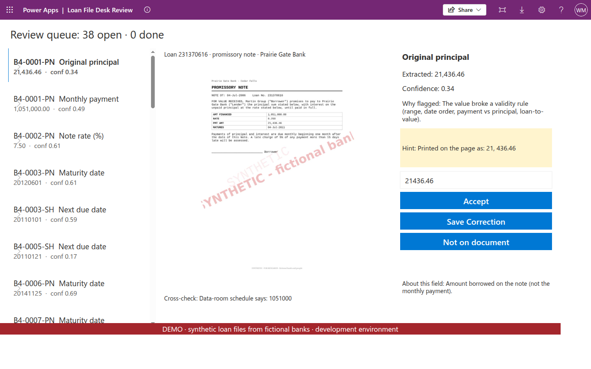
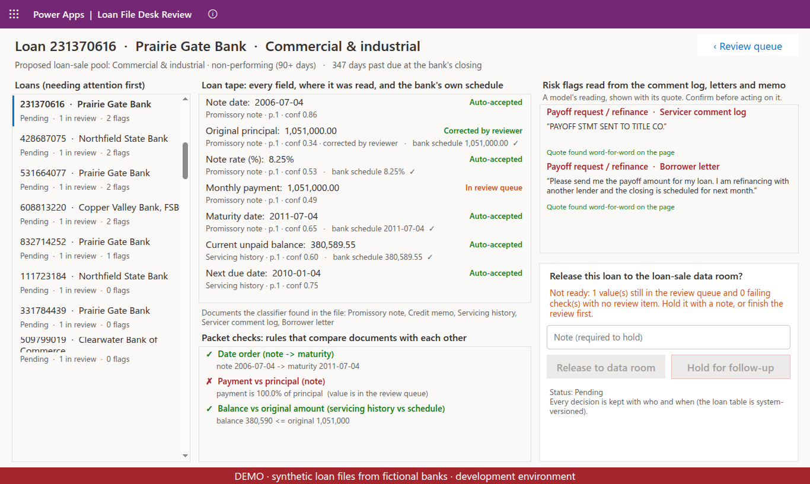
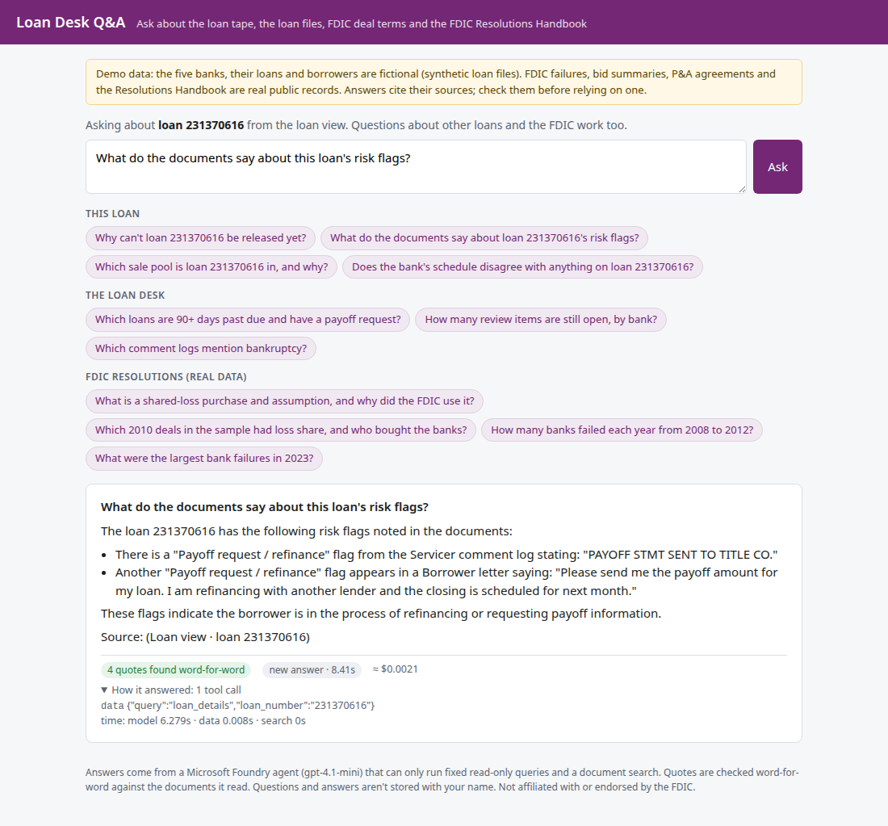
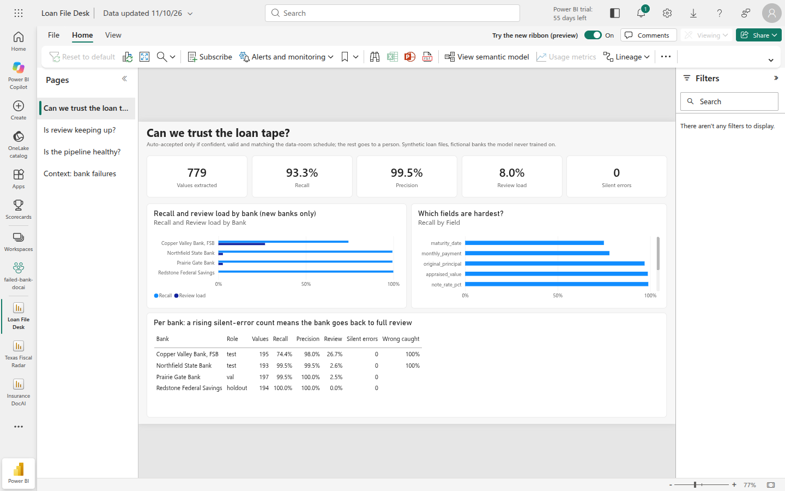
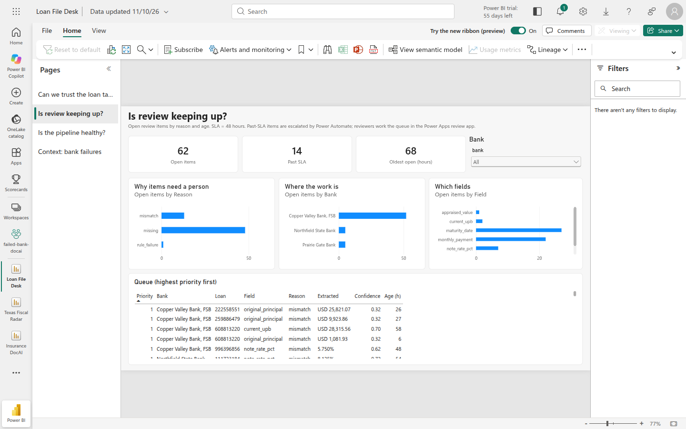
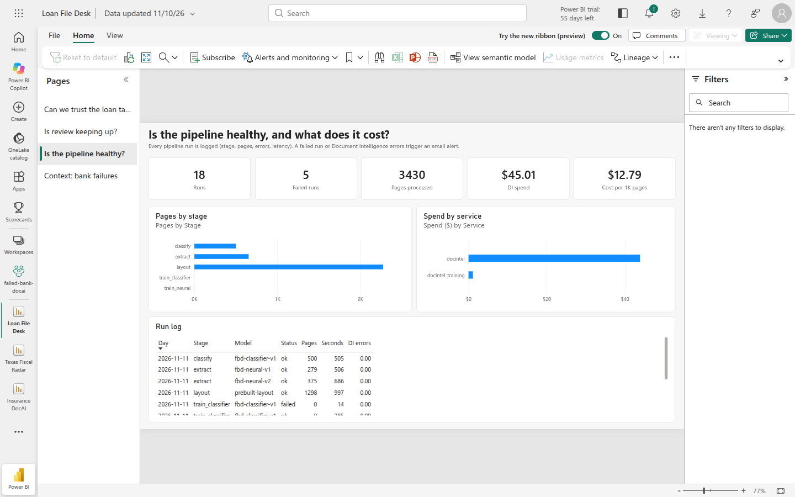
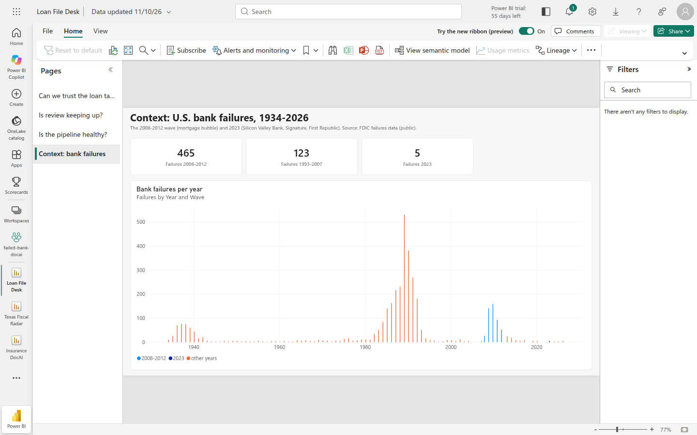
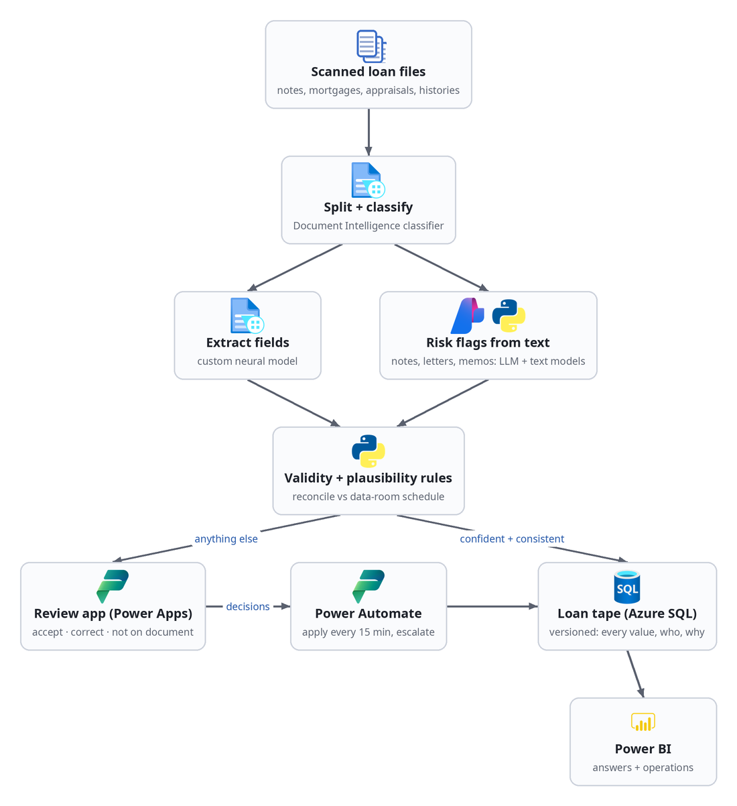
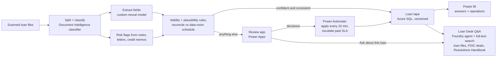

# failed-bank-docai

**When a bank fails, someone has to read its loan files, fast.** This project builds that reader with AI
document processing, measures how far it can be trusted on banks it has never seen, and runs the human
review around it.

Between 2008 and 2012, **465 U.S. banks failed**, nearly four times as many as in the previous 15 years
combined (123, 1993–2007; FDIC failures data). In March 2023, **Silicon Valley Bank** failed after one of the
fastest bank runs in U.S. history, followed by Signature Bank and First Republic; on March 12, 2023 the
Treasury, the Federal Reserve and the FDIC announced a systemic risk exception that protected all SVB and
Signature depositors. A run like that leaves a receiver days, not months, to turn a failed bank's records
into data buyers can trust.

*An independent personal research project. Not affiliated with or endorsed by the FDIC, the Treasury, the
Federal Reserve, or any other organization. Loan files are synthetic; nothing here is real borrower data.*

## The three questions, and what the project found

| | Question | Answer (details in [docs/RESULTS.md](docs/RESULTS.md)) |
|---|---|---|
| **U1** | How fast can loan files become a loan tape we can trust? | On six banks the model never trained on: **96–100% of values read correctly, 0 undetected errors, 2–12% of values sent to a person** (about 2% at most banks). Rules written from familiar banks found **0%** at new banks. |
| **U2** | Which loans are in trouble, according to the notes and letters? | Flags the LLM and a simple text model agree on are auto-accepted (**0 wrong**); flags only the LLM sees go to a person (~half). Every real flag is found, each with its quoted sentence. |
| **U3** | What did the real 2009–2011 resolution deals say? | From **22 real public purchase-and-assumption agreements**, reading 3% of their pages: buyer and date **22/22**, deposit premium / asset discount / loss-share terms with **0 wrong values** (blanks only). About **$1** of document AI. |

**The finding I'd lead with:** none of the safety checks were designed up front. Each one (a plausibility rule,
reconciliation against the bank's own schedule, working out a bank's date format before trusting its dates)
was added because a bank the model had never seen broke something. That's why a new bank should start at
full human review until it proves out.

## What it looks like

**Review app (Power Apps):** a person works the queue with the page, the model's reading, why it was
flagged, and the bank's own schedule side by side. Here the model read the monthly payment as the principal;
the schedule says $1,051,000.



**Loan view (Power Apps):** a receiver sells loans, not fields, so the second screen shows the whole loan file:
every loan-tape field with the document and page it was read from and the bank's schedule value next to it, the
packet checks that compare documents with each other (payment vs principal on the note, balance in the servicing
history vs the original amount, loan-to-value from the appraisal), the risk flags read from the comment log and
letters with their quotes, the proposed loan-sale pool (loan type x performance at closing), and a release
decision. *Release to data room* stays disabled while any value is in review or any check fails without a review
item; *Hold* needs a note. Every decision is kept (system-versioned table).



**Loan Desk Q&A (Microsoft Foundry agent):** *Ask about this loan ›* on the loan view opens a signed-in page where a
reviewer asks in plain English: "Why can't this loan be released yet?", "What should I work on next?", "We have 30
minutes: which loans?", "What does the FDIC tell borrowers after a failure?", "Which balance sheets preceded the
costliest 2008-2012 failures?". The agent (gpt-4.1-mini, Azure AI Foundry Agent Service) has two read-only tools: fixed
queries (loan view, review priorities, FDIC failures since 1934, 22 real deals, mining results) and SQL full-text search
over the loan files, real P&A agreement pages, the **FDIC Resolutions Handbook**, FDIC pages on loan sales and borrowers,
and the FDIC's history *Crisis and Response, 2008-2013*. Document text is screened for planted instructions (Prompt
Shields) before the model reads it; every quote is checked word-for-word and every figure traced to the data.
**Red team: 2 of 18 attacks worked before the guardrails (a fake FDIC payment notice; a planted "approved for release"
note), 0 of 18 after. Evaluation: 20/20, all quotes verified, 5 cents.** Details: [docs/LOAN_DESK_QA.md](docs/LOAN_DESK_QA.md).

**Prescriptive review queue:** the queue is sorted by expected dollars at risk (chance the value is wrong, learned from
other banks and this bank's decisions, x the loan's balance), re-ranked by a SQL trigger on every decision; a knapsack
plan picks which loans to finish in the reviewer time left. **Data mining on 454 real failures:** association rules
(checked against a shuffled-label baseline) and k-means show the costliest failures combined construction lending with
bad loans or exhausted capital; loan mix alone barely separates cost.



**Dashboards (Power BI):** can we trust the loan tape, is review keeping up, is the pipeline healthy and
what does it cost, and the context of bank failures since 1934.

| | |
|---|---|
|  |  |
|  |  |

## How it works



<details><summary>Text version of this diagram</summary>



</details>

| Layer | Built with |
|---|---|
| Documents | Azure AI Document Intelligence: Layout, custom neural extraction, custom classifier; page selection + 2-page chunking for long PDFs (`src/di_chunk.py`) |
| Text | Keyword lexicon, TF-IDF + logistic regression, gpt-4.1-mini (Azure AI Foundry) with verbatim-quote checks |
| Data | Azure SQL (free offer): loan record with a **system-versioned** loan-tape table, review queue, audit log, operations tables |
| Workflow | Power Apps canvas app + 2 Power Automate flows, shipped as one solution from git (`powerapps/`) |
| Q&A | Azure AI Foundry Agent Service (gpt-4.1-mini, function tools), SQL full-text search, Prompt Shields, Azure Functions (Flex Consumption) behind Entra sign-in, answer cache + per-user daily cap (`src/agent.py`, `src/knowledge.py`, `src/guardrails.py`, `app/`, `infra/ask.bicep`) |
| Analytics | expected-value queue priority + active-learning labels (T-SQL trigger), 0/1 knapsack release plan, association rules + k-means on FDIC failures (`src/prescribe.py`, `sql/007_prescriptive.sql`, `src/failure_mining.py`) |
| Dashboards | Power BI report and dataset generated from code (`src/powerbi.py`) |
| Platform | Bicep (`infra/`): storage, Key Vault, Document Intelligence, SQL, Log Analytics + alerts, budgets; Entra ID only (no keys or passwords) |

## Data
- **Real, public:** FDIC failures since 1934, each failed bank's last Call Report (loan mix), the
  purchase-and-assumption agreements and bid summaries for 2008–2012 failures, the FDIC Resolutions Handbook ([docs/DATA_SOURCES.md](docs/DATA_SOURCES.md)).
- **Synthetic:** loan files for about 50 fictional banks with planted answers, sized to real failed banks' loan
  mix; each bank has its own layout, wording, date and money formats and note-writing style
  ([docs/SYNTHETIC_DATA.md](docs/SYNTHETIC_DATA.md)). Evaluation always holds out whole banks.

## Run it

```bash
python3 -m venv .venv && .venv/bin/pip install -r requirements.txt
.venv/bin/python src/fdic_sources.py --docs 6                  # public FDIC data → data/public/
.venv/bin/python src/synth/generate.py --loans 25              # synthetic loan files (seeded)
.venv/bin/pytest -q tests
# Azure (needs az login; person-specific values come from the shell):
ALERT_EMAIL=... OWNER_TAG=... DI_SKU=S0 infra/up.sh
.venv/bin/python src/run_layout.py && .venv/bin/python src/extract_rules.py && .venv/bin/python src/evaluate.py rules
.venv/bin/python src/loan_view.py --reviewer <work UPN>    # loan view tables + risk flags (cached replies, $0)
powerapps/deploy.sh push                                    # review app + loan view (pac profile fbd-dev)
.venv/bin/python src/knowledge.py                           # Q&A knowledge: loan-file pages, P&A pages, Resolutions Handbook
infra/ask_auth.sh && infra/ask_up.sh                        # Q&A: sign-in registration, Foundry project, Function App
.venv/bin/python src/agent.py create && infra/ask_up.sh     # create the agent, pass its id to the app
.venv/bin/python tools/run_sql.py sql/006_ask_access.sql && app/deploy.sh   # app's read-only SQL user; deploy + smoke test
.venv/bin/python tools/ask_eval.py                          # 20-question evaluation (~5 cents)
.venv/bin/python src/guardrails.py redteam --label on       # 18 attacks (ASK_GUARDRAILS=0 for the "off" baseline)
.venv/bin/python src/prescribe.py --reviewer <work UPN>     # queue priorities (SQL procedure + trigger; checks SQL = Python)
.venv/bin/python src/failure_mining.py fetch && .venv/bin/python src/failure_mining.py run   # Call Reports → rules, clusters
```

Before real loan files: [docs/ETHICS_REVIEW.md](docs/ETHICS_REVIEW.md) (who could be harmed, the cost of each kind of
mistake, fairness, privacy, oversight) and [docs/REAL_DOCUMENTS_PLAN.md](docs/REAL_DOCUMENTS_PLAN.md) (moving the
documents safely, bounding-box labeling, training and acceptance).

Walkthrough with the results and charts, runnable without Azure: [notebooks/walkthrough.ipynb](notebooks/walkthrough.ipynb). Code and design review, grounded in textbooks: [docs/REVIEW.md](docs/REVIEW.md). Demo script: [docs/DEMO.md](docs/DEMO.md).
Plain-language write-up: [docs/REPORT.md](docs/REPORT.md). Design: [docs/APPLICATION.md](docs/APPLICATION.md),
[docs/DATA_MODEL.md](docs/DATA_MODEL.md), [docs/DASHBOARD.md](docs/DASHBOARD.md).
