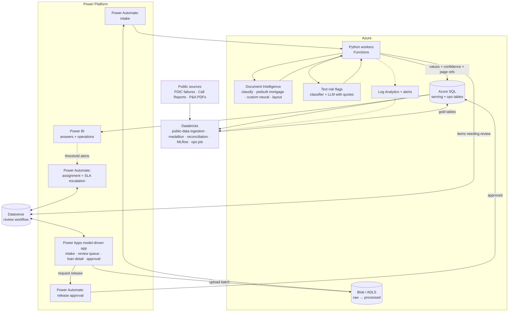

# The application: Receivership Loan File Desk

A working application, not just a pipeline, that simulates a real-world task from the 2008 crisis.

## The real-world problem

A bank fails on a Friday. The receiver has to (1) give bidders and valuation teams accurate loan data
fast, (2) manage the loans the buyer didn't take, and (3) answer borrowers and creditors. All three
depend on **loan files**: scanned notes, deeds of trust, appraisals, payment histories, **servicer comment
logs and borrower letters**. Every bank formats them differently. In 2009–2010 this happened
**two to three times a week** (148 and 157 failures).

**Receivership Loan File Desk** turns a failed bank's loan files into a verified **loan tape** plus
**risk flags from the free text**. Each value carries a confidence score and a link to its source page.
A person reviews anything the system isn't sure about, and a lead signs off before the data is released.

## Hypothetical users (to be validated by usage, see `DASHBOARD.md`)

| User | What they do in the app |
|---|---|
| **Intake coordinator** | Registers the failed bank, uploads loan-file batches, watches processing |
| **Loan file reviewer** | Works the review queue: confirms or corrects fields and text flags, side by side with the page |
| **Lead** | Sees portfolio status and risk flags, approves the loan tape for release |
| **Auditor** | Traces any value to its document, model version and reviewer |

## Components

| Capability | How it's built |
|---|---|
| **Azure AI Document Intelligence** | **Custom classifier** splits each loan-file PDF into documents and labels them. **Prebuilt mortgage models** (1003, 1004, Closing Disclosure). **Custom neural models** for promissory notes and payment histories. **Layout** for long legal documents (real public P&A agreements, 60–170 pages). |
| **Unstructured text** | Servicer comment logs and borrower letters (synthetic), detect *bankruptcy, litigation, hardship/forbearance, fraud, property damage, payoff request*, quoting the supporting sentence. P&A agreement terms (buyer, date, premium/discount, loss-share coverage), each with its quoted source. The LLM never produces numbers. |
| **Model building** | Custom DI models evaluated on **held-out banks**. A text risk-flag classifier: TF-IDF + logistic regression baseline vs a fine-tuned small transformer vs a prompted LLM, compared on cost and accuracy. Confidence calibration for review routing. |
| **Power Platform** | **Power Apps** (model-driven app on Dataverse): bank intake, review queue, loan detail, release approval. **Power Automate**: (1) intake flow: new batch → start processing; (2) review assignment and SLA escalation; (3) **release approval**: lead approves → loan tape published; (4) daily status email; (5) alert flows from Power BI thresholds. **Power BI**: answer report (U1–U3) + **operations monitoring report** (`DASHBOARD.md`). Solution kept in source control, dev → test promotion. |
| **Azure data engineering** | Blob/ADLS landing (raw → processed), event-driven Python workers (Functions), Key Vault, managed identity, Log Analytics + alerts, Bicep infrastructure, cost budgets. |
| **Databricks** | Ingests the public sources (FDIC failures API, Call Reports, P&A agreement text); medallion (bronze/silver/gold); **reconciliation** against the servicing system; text-model training with MLflow; daily ops-metrics job; writes gold tables to Azure SQL. |
| **Azure SQL** | The serving layer: loan tape, extractions, versioned field values, review decisions, audit events, ops/monitoring tables. Feeds Power BI, Power Apps and the API. Dataverse holds only the review workflow. |
| **Mortgage domain** | Mortgage document types, loan-tape fields (UPB, note rate, maturity, LTV, delinquency), the resolution and receivership process. |
| **Controls** | Audit trail per value, versioned corrections, PII redaction, least privilege, no real borrower data. |

## Architecture

## Data captured, storage, processing, and what reviewers can update

See `DATA_MODEL.md`: fields per document type, the DI output we keep, the three storage layers (Blob
evidence, Azure SQL record, Dataverse workflow), the 9 processing stages, and the update actions
(corrections are versioned; the original document is never edited).

## Screens (Power Apps)

1. **Banks**: failed banks being worked (seeded from the real public failures list: name, closing date,
   buyer, loan mix from the last Call Report), with status (receiving → processing → in review → approved).
2. **Batch intake**: upload loan files; Power Automate takes it from there.
3. **Review queue**: items sorted by risk and SLA; filters by bank, document type, reason (low confidence,
   reconciliation mismatch, new-bank burn-in, text flag).
4. **Review item**: page image with the value highlighted on the left; the value, confidence, rule hits
   and servicing-system value on the right; buttons Confirm / Correct / Not on document.
5. **Loan detail**: every field for one loan with its source page, plus text flags with quoted sentences.
6. **Release**: tape summary (counts, review completeness, open exceptions) → submit for approval.

## Real vs synthetic (state this in every demo)

| Real (public) | Synthetic (planted ground truth) |
|---|---|
| Which banks failed, when, buyer, cost to the insurance fund | Loan files (notes, deeds, appraisals, payment histories) |
| Each bank's real loan mix (sizes and mixes the synthetic portfolio) | Servicer comment logs and borrower letters |
| P&A agreements (2008–2012) | The servicing system of record |

## Demo script (5 minutes)
1. Pick a real 2009 failure: show its loan mix, its P&A agreement, and the loss-share terms the pipeline extracted.
2. Upload a batch of its (synthetic) loan files → the flow runs → the Banks screen moves to "in review".
3. Open the review queue: a low-confidence rate, a reconciliation mismatch, a bankruptcy flag from a
   servicer note with the sentence quoted. Fix them.
4. Release: approval flow → the lead approves → the loan tape appears in Power BI.
5. Operations report: pipeline health, review SLA, silent-error rate, cost per 1,000 pages.

*An independent personal project. Not affiliated with or endorsed by any agency or organization.*
