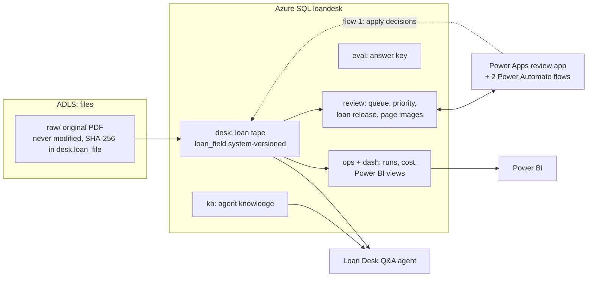

# Data model: what Document Intelligence captures, how it's stored and processed, and what Power Apps updates

## 1. What Document Intelligence captures, per document type

A loan file arrives as one scanned PDF holding many documents. DI does three jobs:

| Step | DI model | Output we keep |
|---|---|---|
| **Split + classify** | Custom classifier | For each document in the PDF: `docType`, page range, confidence |
| **Extract fields** | Prebuilt mortgage / custom neural (per type below) | Each field: value, confidence, **page + bounding box**, text span |
| **Read everything** | Layout (runs under all of the above) | Every page: lines, words, tables, selection marks (checkboxes), reading order. Feeds the text models and the "show me where" highlight |

Fields to capture (canonical names live in `schema/loan_fields.yaml`):

| Document | DI model | Fields captured |
|---|---|---|
| Promissory note | custom neural | loan number, borrower name(s), note date, original principal, note rate, first payment date, maturity date, monthly P&I payment, ARM index/margin (if any), late-charge terms, signature present |
| Mortgage / deed of trust | custom neural | borrower(s), lender, property address, legal description, recording date + instrument number, county, secured amount |
| Appraisal (Form 1004) | `prebuilt-mortgage.us.1004` | property address, appraised value, effective date, property type, occupancy, appraiser |
| Loan application (Form 1003) | `prebuilt-mortgage.us.1003` | borrower, income, loan purpose, requested amount, property |
| Closing Disclosure | `prebuilt-mortgage.us.closingDisclosure` | loan amount, interest rate, monthly payment, closing date, loan term, cash to close |
| Payment history | custom neural (tables) | loan number, as-of date, **current UPB**, next due date, last payment date, escrow balance, the payment table |
| Servicer comment log | Layout → **text models** | full text by date entry → risk flags (bankruptcy, litigation, hardship, fraud, damage, payoff) + the quoted sentence |
| Borrower letter | Layout → **text models** | full text → same risk flags + the request type |
| P&A agreement (real, public) | Layout → **clause extraction** | buyer, effective date, deposit premium, assets purchased/excluded, loss-share terms (each with the quoted clause) |

What one DI field looks like in the raw JSON (simplified):

```json
"NoteRate": {
  "type": "number", "valueNumber": 6.375, "content": "6.375%",
  "confidence": 0.94,
  "boundingRegions": [{"pageNumber": 2, "polygon": [1.1, 3.2, 2.0, 3.2, 2.0, 3.4, 1.1, 3.4]}],
  "spans": [{"offset": 1834, "length": 6}]
}
```

`confidence` drives review routing. `boundingRegions` lets the review screen highlight the exact spot
on the page. `spans` ties the value back to the Layout text.

## 2. How it's stored

**As built:** Blob/ADLS for the original files, Azure SQL for everything else. The review workflow (queue,
SLA, release decisions) lives in SQL too, read and written by the Power Apps canvas app through the SQL
connector; there is no Dataverse. There is no Databricks: runs are scripted Python batches. Every table,
column and row count is in **[SCHEMA.md](SCHEMA.md)**, generated from the live database by
`tools/schema_doc.py`.



| Layer | Holds | Status |
|---|---|---|
| **ADLS** `raw/` | Original PDFs, never modified; SHA-256 recorded in `desk.loan_file` | Built |
| **Azure SQL** `desk` | The loan tape: files, documents, extracted values, the current and historical value of every loan field, text flags, review decisions, audit events | Built |
| **Azure SQL** `review` | What the review app works on: review items (system-versioned), priority order, loan-level release decisions, page images, manual keying | Built |
| **Azure SQL** `eval`, `kb`, `ops`, `ref`, `dash` | Answer key, agent knowledge, run log and cost, Power BI views | Built |
| DI JSON for every model run in `docintel/` | Kept locally under `samples/synthetic/docintel/` (not tracked in git), not in the lake | Planned |
| **Dataverse** for tasks, assignment and approvals | Not used; the workflow is in SQL | Not built |
| **Databricks** medallion copy and MLflow | For reconciliation across a whole receivership | Not built |

### Core tables (`desk` schema)

| Table | Key columns |
|---|---|
| `bank` | bank_id, fdic_cert, name, closing_date, acquirer, layout_family, split (train/test bank), status |
| `loan_file` | file_id, bank_id, blob_path, sha256, pages, version, received_at |
| `document` | doc_id, file_id, doc_type, page_from, page_to, classifier_confidence |
| `extraction` | extraction_id, doc_id, loan_id, field, raw_value, normalized_value, confidence, page, bbox, model_id, model_version, run_id |
| `loan` | loan_id, bank_id, loan_number |
| `loan_field` | loan_id, field, value, **source** (model / reviewer), extraction_id, changed_by, reason, valid_from, valid_to. **System-versioned**: history in `loan_field_history` |
| `text_flag` | flag_id, doc_id, loan_id, flag, quote, page, confidence, quote_verified, model_id, status |
| `review_item` | item_id, loan_id, field_or_flag, reason, priority, status, sla_due |
| `review_decision` | item_id, decision, new_value, reviewer, comment, decided_at |
| `audit_event` | actor, action, entity, entity_id, before_json, after_json (append-only) |

Operations (`ops`): `run_log`, `stage_metric`, `cost_daily`, `daily` (empty; planned) and the `review_sla` view.

`loan_field` is a SQL Server system-versioned table. A correction never overwrites: SQL Server moves the old
row to `loan_field_history` with the time it was valid. That's the audit trail an auditor expects.

## 3. How it's processed (one loan file, end to end)

As built, stages 2–8 run as scripted batches (`src/`), not event-driven; intake by upload, the intake flow,
the Dataverse task and the approval flow in stage 9 are planned. Release is a per-loan decision
(pending / released / hold) in `review.loan`.

| # | Stage | What happens | Status written |
|---|---|---|---|
| 1 | Intake | Upload via Power Apps → Blob `raw/`; hash computed; **Power Automate intake flow** starts processing | `received` |
| 2 | Classify | DI classifier splits the PDF into documents | `classified` |
| 3 | Extract | Each document goes to its DI model; JSON saved to Blob; values into `extraction` | `extracted` |
| 4 | Read text | Layout text for comment logs/letters → text models → `text_flag` (quote checked against the page text) | `flagged` |
| 5 | Normalize + validate | Dates, money, percents normalized; schema rules (rate 0–25%, maturity after note date, UPB ≤ original) | `validated` |
| 6 | Reconcile | Compare with the servicing system (synthetic): rate, original principal, maturity, UPB | `reconciled` |
| 7 | Route | Low confidence, rule failure, mismatch, text flag, or new-bank burn-in → `review_item` + Dataverse task; the rest is auto-accepted | `in_review` / `accepted` |
| 8 | Review | Reviewer decides in Power Apps → `review_decision` + new `loan_field_value` version | `reviewed` |
| 9 | Release | Asset manager requests release → **approval flow** → gold loan tape published | `released` |

## 4. "Updating the documents" with Power Platform: what it should and shouldn't do

As built: **correct**, **confirm** and **not on document** in the review app (applied to the loan tape by
flow 1), escalation past SLA (flow 2), and per-loan release / hold. The other rows are the design.

**Rule: never edit the original document.** In a receivership the loan file is evidence. Power Apps
updates **the data about the document** and keeps every version, and it can add **new** documents to the file.

| Action in Power Apps | What actually changes | Power Automate |
|---|---|---|
| **Correct a value** (e.g. rate read as 6.875, page says 6.375) | New `loan_field_value` version (source = reviewer, reason) | Notifies the item's owner; the change counts toward the model's error stats |
| **Confirm** a flagged value | Version marked confirmed by reviewer | Closes the task |
| **Not on document** | Field set to missing, with a reason | May create a document request |
| **Reclassify a page** (appraisal labeled as note) | `document.doc_type` changes (versioned) | **Re-runs extraction** for that document |
| **Split / merge** documents in a file | `document` page ranges change | Re-runs extraction |
| **Upload a replacement scan** (bad page, missing document) | **New** file version in `raw/`; the old one is kept | Intake flow re-processes only the new file |
| **Request a missing document** | Document request record | Emails the custodian/servicer; SLA reminders |
| **Add a text flag** the model missed / **dismiss** a false one | `text_flag` added or dismissed by the reviewer | Feeds text-model evaluation |
| **Approve release** of a bank's loan tape | Bank status → `released`; gold tape snapshot | Approval flow; email to stakeholders |

Each reviewer decision is also **labeled training data**: corrections and reclassifications are what the
next custom-model version trains on. That closes the loop: review → better model → less review.
