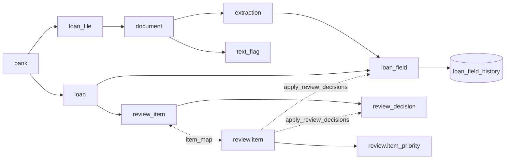

# Database schema (Azure SQL `loandesk`)

Generated from the live database by `tools/schema_doc.py` on 2026-11-16: 33 tables, 10 views, 4 procedures/triggers. Row counts are as of that date. Rerun the script after changing a table; don't edit this file by hand.

Design and reasoning: [DATA_MODEL.md](DATA_MODEL.md). Power BI pages: [DASHBOARD.md](DASHBOARD.md).

## How the main tables connect

Every value on the loan tape traces back through `extraction_id` to the page and bounding box it was read from. A correction never overwrites: SQL Server moves the old row to the history table with its time range.

## Summary

| Object | Kind | Rows | Created by |
|---|---|---:|---|
| `dash.v_ai_vs_manual` | view |  | `src/turnaround.py` |
| `dash.v_bank` | view |  | `sql/002_dash.sql` |
| `dash.v_cost` | view |  | `sql/002_dash.sql` |
| `dash.v_cycle` | view |  | `src/turnaround.py` |
| `dash.v_manual` | view |  | `src/turnaround.py` |
| `dash.v_quality` | view |  | `sql/002_dash.sql` |
| `dash.v_queue` | view |  | `sql/002_dash.sql` |
| `dash.v_runs` | view |  | `sql/002_dash.sql` |
| `dash.v_touch` | view |  | `src/turnaround.py` |
| `desk.audit_event` | table | 22 | `sql/001_schema.sql` |
| `desk.bank` | table | 5 | `sql/001_schema.sql` |
| `desk.document` | table | 815 | `sql/001_schema.sql` |
| `desk.extraction` | table | 968 | `sql/001_schema.sql` |
| `desk.loan` | table | 125 | `sql/001_schema.sql` |
| `desk.loan_field` | table, system-versioned | 967 | `sql/001_schema.sql` |
| `desk.loan_field_history` | history table | 2 | SQL Server (history of `desk.loan_field`) |
| `desk.loan_file` | table | 125 | `sql/001_schema.sql` |
| `desk.review_decision` | table | 2 | `sql/001_schema.sql` |
| `desk.review_item` | table | 38 | `sql/001_schema.sql` |
| `desk.text_flag` | table | 95 | `sql/001_schema.sql` |
| `eval.field_outcome` | table | 972 | `sql/002_dash.sql` |
| `eval.field_truth` | table | 106 | `src/turnaround.py` |
| `kb.deal` | table | 22 | `sql/005_knowledge.sql` |
| `kb.failure` | table | 3,524 | `sql/005_knowledge.sql` |
| `kb.failure_cluster` | table | 3 | `src/failure_mining.py` |
| `kb.failure_profile` | table | 454 | `src/failure_mining.py` |
| `kb.mining_rule` | table | 45 | `src/failure_mining.py` |
| `kb.passage` | table | 1,398 | `sql/005_knowledge.sql` |
| `ops.cost_daily` | table | 4 | `sql/001_schema.sql` |
| `ops.daily` | table | 0 | `sql/001_schema.sql` |
| `ops.run_log` | table | 79 | `sql/001_schema.sql` |
| `ops.stage_metric` | table | 395 | `sql/001_schema.sql` |
| `ops.review_sla` | view |  | `sql/001_schema.sql` |
| `ref.failure_year` | table | 88 | `sql/002_dash.sql` |
| `review.document` | table | 28 | `src/review_projection.py` |
| `review.item` | table, system-versioned | 36 | `src/review_projection.py` |
| `review.item_history` | history table | 40 | SQL Server (history of `review.item`) |
| `review.item_map` | table | 36 | `src/review_projection.py` |
| `review.item_priority` | table | 36 | `sql/007_prescriptive.sql` |
| `review.loan` | table, system-versioned | 125 | `src/loan_view.py` |
| `review.loan_detail` | table | 2,348 | `src/loan_view.py` |
| `review.loan_history` | history table | 375 | SQL Server (history of `review.loan`) |
| `review.manual_entry` | table | 0 | `src/turnaround.py` |
| `desk.apply_review_decisions` | stored procedure | | `src/review_projection.py` |
| `desk.escalate_past_sla` | stored procedure | | `sql/004_escalation.sql` |
| `review.refresh_item_priority` | stored procedure | | `sql/007_prescriptive.sql` |
| `review.tr_item_priority` | trigger | | `sql/007_prescriptive.sql` |

## `dash`

Views shaped for Power BI.

### `dash.v_ai_vs_manual`

View · created by `src/turnaround.py`

| Column | Type | Null | Key |
|---|---|---|---|
| `process` | varchar(13) | no |  |
| `sort_order` | int | no |  |
| `fields` | int | yes |  |
| `model_error_rate` | float | yes |  |
| `final_error_rate` | float | yes |  |
| `straight_through_rate` | float | yes |  |
| `human_seconds_per_field` | float | yes |  |
| `timed_samples` | int | yes |  |

### `dash.v_bank`

View · created by `sql/002_dash.sql`

| Column | Type | Null | Key |
|---|---|---|---|
| `bank_id` | int | no |  |
| `name` | nvarchar(200) | no |  |
| `split` | nvarchar(10) | no |  |
| `layout_family` | nvarchar(20) | yes |  |
| `status` | nvarchar(20) | no |  |
| `closing_date` | date | yes |  |
| `loans` | int | yes |  |
| `field_values` | int | yes |  |
| `open_items` | int | yes |  |

### `dash.v_cost`

View · created by `sql/002_dash.sql`

| Column | Type | Null | Key |
|---|---|---|---|
| `day` | date | no |  |
| `service` | nvarchar(30) | no |  |
| `units` | float | no |  |
| `cost_usd` | float | yes |  |

### `dash.v_cycle`

View · created by `src/turnaround.py`

| Column | Type | Null | Key |
|---|---|---|---|
| `loan_id` | int | no |  |
| `loan_number` | nvarchar(40) | no |  |
| `bank` | nvarchar(200) | no |  |
| `received_at` | datetime2 | yes |  |
| `review_items` | int | yes |  |
| `open_items` | int | yes |  |
| `ready_at` | datetime2 | yes |  |
| `cycle_hours` | numeric(17,6) | yes |  |

### `dash.v_manual`

View · created by `src/turnaround.py`

| Column | Type | Null | Key |
|---|---|---|---|
| `entry_id` | int | no |  |
| `session_id` | nvarchar(36) | no |  |
| `doc_id` | nvarchar(16) | no |  |
| `field` | nvarchar(64) | no |  |
| `entered_value` | float | yes |  |
| `true_value` | float | yes |  |
| `printed` | bit | no |  |
| `seconds_on_doc` | int | no |  |
| `entered_by` | nvarchar(64) | yes |  |
| `entered_at` | datetime2 | no |  |
| `is_correct` | int | no |  |

### `dash.v_quality`

View · created by `sql/002_dash.sql`

| Column | Type | Null | Key |
|---|---|---|---|
| `bank` | nvarchar(200) | no |  |
| `split` | nvarchar(10) | no |  |
| `field` | nvarchar(60) | no |  |
| `model_id` | nvarchar(100) | no |  |
| `outcome` | nvarchar(10) | no |  |
| `routed` | nvarchar(10) | no |  |
| `reasons` | nvarchar(100) | yes |  |
| `silent_error` | int | yes |  |
| `confidence` | decimal(5,4) | yes |  |
| `scanned` | int | yes |  |
| `is_correct` | int | no |  |
| `is_wrong` | int | no |  |
| `is_missing` | int | no |  |
| `is_review` | int | no |  |

### `dash.v_queue`

View · created by `sql/002_dash.sql`

| Column | Type | Null | Key |
|---|---|---|---|
| `item_id` | bigint | no |  |
| `bank` | nvarchar(200) | no |  |
| `loan_number` | nvarchar(40) | no |  |
| `field` | nvarchar(60) | no |  |
| `reason` | nvarchar(20) | no |  |
| `priority` | tinyint | no |  |
| `status` | nvarchar(12) | no |  |
| `extracted` | nvarchar(400) | yes |  |
| `confidence` | decimal(5,4) | yes |  |
| `created_at` | datetime2 | no |  |
| `sla_due` | datetime2 | yes |  |
| `age_hours` | int | yes |  |
| `breached` | int | no |  |
| `decision` | nvarchar(20) | yes |  |
| `new_value` | nvarchar(400) | yes |  |
| `reviewer` | nvarchar(200) | yes |  |
| `decided_at` | datetime2 | yes |  |

### `dash.v_runs`

View · created by `sql/002_dash.sql`

| Column | Type | Null | Key |
|---|---|---|---|
| `run_id` | uniqueidentifier | no |  |
| `day` | date | yes |  |
| `stage` | nvarchar(20) | no |  |
| `status` | nvarchar(10) | no |  |
| `model_id` | nvarchar(100) | yes |  |
| `pages` | int | yes |  |
| `seconds` | int | yes |  |
| `di_errors` | float | yes |  |
| `items_out` | float | yes |  |
| `failed` | int | no |  |

### `dash.v_touch`

View · created by `src/turnaround.py`

| Column | Type | Null | Key |
|---|---|---|---|
| `item_id` | int | no |  |
| `doc_id` | nvarchar(16) | no |  |
| `field` | nvarchar(64) | no |  |
| `reason` | nvarchar(256) | yes |  |
| `decision` | nvarchar(20) | no |  |
| `opened_at` | datetime2 | yes |  |
| `reviewed_at` | datetime2 | yes |  |
| `seconds_on_item` | int | yes |  |
| `seconds_counted` | int | yes |  |

## `desk`

The loan tape: the system of record. Files → documents → extracted values → one current value per loan per field (`loan_field`, system-versioned so every correction keeps the old value, who changed it and why).

### `desk.audit_event`

Table · 22 rows · created by `sql/001_schema.sql`

| Column | Type | Null | Key |
|---|---|---|---|
| `event_id` | bigint | no | PK |
| `at` | datetime2 | no |  |
| `actor` | nvarchar(200) | no |  |
| `action` | nvarchar(60) | no |  |
| `entity` | nvarchar(60) | no |  |
| `entity_id` | nvarchar(60) | no |  |
| `before_json` | nvarchar(max) | yes |  |
| `after_json` | nvarchar(max) | yes |  |

### `desk.bank`

Table · 5 rows · created by `sql/001_schema.sql`

| Column | Type | Null | Key |
|---|---|---|---|
| `bank_id` | int | no | PK |
| `fdic_cert` | int | yes |  |
| `name` | nvarchar(200) | no |  |
| `closing_date` | date | yes |  |
| `acquirer` | nvarchar(200) | yes |  |
| `layout_family` | nvarchar(20) | yes |  |
| `split` | nvarchar(10) | no |  |
| `status` | nvarchar(20) | no |  |

### `desk.document`

Table · 815 rows · created by `sql/001_schema.sql`

| Column | Type | Null | Key |
|---|---|---|---|
| `doc_id` | int | no | PK |
| `file_id` | int | no | → `desk.loan_file.file_id` |
| `doc_type` | nvarchar(40) | no |  |
| `page_from` | int | no |  |
| `page_to` | int | no |  |
| `classifier_confidence` | decimal(5,4) | yes |  |
| `source` | nvarchar(10) | no |  |

### `desk.extraction`

Table · 968 rows · created by `sql/001_schema.sql`

| Column | Type | Null | Key |
|---|---|---|---|
| `extraction_id` | bigint | no | PK |
| `doc_id` | int | no | → `desk.document.doc_id` |
| `loan_id` | int | yes | → `desk.loan.loan_id` |
| `field` | nvarchar(60) | no |  |
| `raw_value` | nvarchar(400) | yes |  |
| `normalized_value` | nvarchar(400) | yes |  |
| `confidence` | decimal(5,4) | yes |  |
| `page` | int | yes |  |
| `bbox` | nvarchar(200) | yes |  |
| `model_id` | nvarchar(100) | no |  |
| `model_version` | nvarchar(40) | yes |  |
| `run_id` | uniqueidentifier | no |  |
| `run_at` | datetime2 | no |  |

### `desk.loan`

Table · 125 rows · created by `sql/001_schema.sql`

| Column | Type | Null | Key |
|---|---|---|---|
| `loan_id` | int | no | PK |
| `bank_id` | int | no | → `desk.bank.bank_id` |
| `loan_number` | nvarchar(40) | no |  |

### `desk.loan_field`

Table · 967 rows · system-versioned, history in `desk.loan_field_history` · created by `sql/001_schema.sql`

| Column | Type | Null | Key |
|---|---|---|---|
| `loan_id` | int | no | PK → `desk.loan.loan_id` |
| `field` | nvarchar(60) | no | PK |
| `value` | nvarchar(400) | yes |  |
| `source` | nvarchar(20) | no |  |
| `extraction_id` | bigint | yes | → `desk.extraction.extraction_id` |
| `changed_by` | nvarchar(200) | no |  |
| `reason` | nvarchar(400) | yes |  |
| `valid_from` | datetime2 | no |  |
| `valid_to` | datetime2 | no |  |

### `desk.loan_file`

Table · 125 rows · created by `sql/001_schema.sql`

| Column | Type | Null | Key |
|---|---|---|---|
| `file_id` | int | no | PK |
| `bank_id` | int | no | → `desk.bank.bank_id` |
| `blob_path` | nvarchar(400) | no |  |
| `sha256` | char(64) | no |  |
| `pages` | int | no |  |
| `version` | int | no |  |
| `received_at` | datetime2 | no |  |

### `desk.review_decision`

Table · 2 rows · created by `sql/001_schema.sql`

| Column | Type | Null | Key |
|---|---|---|---|
| `decision_id` | bigint | no | PK |
| `item_id` | bigint | no | → `desk.review_item.item_id` |
| `decision` | nvarchar(20) | no |  |
| `new_value` | nvarchar(400) | yes |  |
| `reviewer` | nvarchar(200) | no |  |
| `comment` | nvarchar(1000) | yes |  |
| `decided_at` | datetime2 | no |  |

### `desk.review_item`

Table · 38 rows · created by `sql/001_schema.sql`

| Column | Type | Null | Key |
|---|---|---|---|
| `item_id` | bigint | no | PK |
| `loan_id` | int | no | → `desk.loan.loan_id` |
| `field_or_flag` | nvarchar(60) | no |  |
| `reason` | nvarchar(20) | no |  |
| `priority` | tinyint | no |  |
| `status` | nvarchar(12) | no |  |
| `created_at` | datetime2 | no |  |
| `sla_due` | datetime2 | yes |  |

### `desk.text_flag`

Table · 95 rows · created by `sql/001_schema.sql`

| Column | Type | Null | Key |
|---|---|---|---|
| `flag_id` | bigint | no | PK |
| `doc_id` | int | no | → `desk.document.doc_id` |
| `loan_id` | int | yes | → `desk.loan.loan_id` |
| `flag` | nvarchar(40) | no |  |
| `quote` | nvarchar(1000) | no |  |
| `page` | int | yes |  |
| `confidence` | decimal(5,4) | yes |  |
| `quote_verified` | bit | no |  |
| `model_id` | nvarchar(100) | no |  |
| `status` | nvarchar(12) | no |  |

## `eval`

The planted answer key for the synthetic loan files, used to score the model and the people.

### `eval.field_outcome`

Table · 972 rows · created by `sql/002_dash.sql`

| Column | Type | Null | Key |
|---|---|---|---|
| `loan_id` | int | no | PK |
| `bank_id` | int | no |  |
| `field` | nvarchar(60) | no | PK |
| `model_id` | nvarchar(100) | no | PK |
| `outcome` | nvarchar(10) | no |  |
| `routed` | nvarchar(10) | no |  |
| `reasons` | nvarchar(100) | yes |  |
| `silent_error` | bit | no |  |
| `confidence` | decimal(5,4) | yes |  |
| `scanned` | bit | no |  |

### `eval.field_truth`

Table · 106 rows · created by `src/turnaround.py`

| Column | Type | Null | Key |
|---|---|---|---|
| `doc_id` | nvarchar(16) | no | PK |
| `field` | nvarchar(64) | no | PK |
| `true_value` | float | yes |  |
| `printed` | bit | no |  |

## `kb`

Knowledge for the Loan Desk Q&A agent (SQL full-text, no search service) and the failure-pattern analysis. Built from public FDIC data.

### `kb.deal`

Table · 22 rows · created by `sql/005_knowledge.sql`

| Column | Type | Null | Key |
|---|---|---|---|
| `cert` | int | no | PK |
| `bank` | nvarchar(120) | no |  |
| `city` | nvarchar(80) | yes |  |
| `state` | nchar(2) | yes |  |
| `fail_date` | date | yes |  |
| `buyer` | nvarchar(200) | yes |  |
| `transaction_type` | nvarchar(120) | yes |  |
| `deposit_premium` | nvarchar(40) | yes |  |
| `asset_discount_k` | nvarchar(40) | yes |  |
| `sf_loss_share` | nvarchar(40) | yes |  |
| `commercial_loss_share` | nvarchar(40) | yes |  |
| `loss_share` | bit | yes |  |
| `bid_summary_url` | nvarchar(400) | yes |  |
| `pa_agreement_url` | nvarchar(400) | yes |  |

### `kb.failure`

Table · 3,524 rows · created by `sql/005_knowledge.sql`

| Column | Type | Null | Key |
|---|---|---|---|
| `failure_id` | int | no | PK |
| `cert` | int | yes |  |
| `bank` | nvarchar(120) | no |  |
| `city` | nvarchar(80) | yes |  |
| `state` | nchar(2) | yes |  |
| `fail_date` | date | no |  |
| `fail_year` | int | no |  |
| `resolution` | nvarchar(20) | yes |  |
| `acquirer` | nvarchar(200) | yes |  |
| `assets_k` | bigint | yes |  |
| `deposits_k` | bigint | yes |  |
| `cost_k` | bigint | yes |  |

### `kb.failure_cluster`

Table · 3 rows · created by `src/failure_mining.py`

| Column | Type | Null | Key |
|---|---|---|---|
| `cluster_id` | int | no | PK |
| `label` | nvarchar(200) | yes |  |
| `banks` | int | yes |  |
| `median_loss_rate` | float | yes |  |
| `costly_share` | float | yes |  |
| `median_assets_k` | float | yes |  |
| `mix_json` | nvarchar(2000) | yes |  |

### `kb.failure_profile`

Table · 454 rows · created by `src/failure_mining.py`

| Column | Type | Null | Key |
|---|---|---|---|
| `cert` | int | no | PK |
| `bank` | nvarchar(120) | yes |  |
| `state` | nchar(2) | yes |  |
| `fail_date` | date | yes |  |
| `report_date` | nvarchar(8) | yes |  |
| `assets_k` | bigint | yes |  |
| `cost_k` | bigint | yes |  |
| `loss_rate` | float | yes |  |
| `costly` | bit | yes |  |
| `cluster_id` | int | yes |  |
| `construction_share` | float | yes |  |
| `cre_share` | float | yes |  |
| `residential_share` | float | yes |  |
| `multifamily_share` | float | yes |  |
| `farm_share` | float | yes |  |
| `ci_share` | float | yes |  |
| `consumer_share` | float | yes |  |
| `brokered_share` | float | yes |  |
| `equity_ratio` | float | yes |  |
| `noncurrent_ratio` | float | yes |  |
| `loan_to_asset` | float | yes |  |

### `kb.mining_rule`

Table · 45 rows · created by `src/failure_mining.py`

| Column | Type | Null | Key |
|---|---|---|---|
| `rule_id` | int | no | PK |
| `antecedent` | nvarchar(300) | no |  |
| `support` | float | yes |  |
| `banks` | int | yes |  |
| `confidence` | float | yes |  |
| `lift` | float | yes |  |
| `beats_chance` | bit | yes |  |
| `chance_lift_95` | float | yes |  |

### `kb.passage`

Table · 1,398 rows · created by `sql/005_knowledge.sql`

| Column | Type | Null | Key |
|---|---|---|---|
| `passage_id` | int | no | PK |
| `source` | nvarchar(20) | no |  |
| `ref` | nvarchar(40) | no |  |
| `loan_id` | int | yes |  |
| `bank` | nvarchar(120) | yes |  |
| `doc_type` | nvarchar(40) | yes |  |
| `page` | int | no |  |
| `title` | nvarchar(200) | no |  |
| `url` | nvarchar(400) | yes |  |
| `text` | nvarchar(max) | no |  |

## `ops`

Pipeline runs, per-run metrics, daily cost and review deadlines.

### `ops.cost_daily`

Table · 4 rows · created by `sql/001_schema.sql`

| Column | Type | Null | Key |
|---|---|---|---|
| `day` | date | no | PK |
| `service` | nvarchar(30) | no | PK |
| `units` | float | no |  |
| `cost_usd` | decimal(10,4) | no |  |

### `ops.daily`

Table · 0 rows · created by `sql/001_schema.sql`

| Column | Type | Null | Key |
|---|---|---|---|
| `day` | date | no | PK |
| `source` | nvarchar(30) | no | PK |
| `metric` | nvarchar(60) | no | PK |
| `value` | float | no |  |

### `ops.run_log`

Table · 79 rows · created by `sql/001_schema.sql`

| Column | Type | Null | Key |
|---|---|---|---|
| `run_id` | uniqueidentifier | no | PK |
| `stage` | nvarchar(20) | no |  |
| `bank_id` | int | yes |  |
| `started_at` | datetime2 | no |  |
| `ended_at` | datetime2 | yes |  |
| `status` | nvarchar(10) | no |  |
| `error` | nvarchar(2000) | yes |  |
| `pages` | int | yes |  |
| `model_id` | nvarchar(100) | yes |  |

### `ops.stage_metric`

Table · 395 rows · created by `sql/001_schema.sql`

| Column | Type | Null | Key |
|---|---|---|---|
| `run_id` | uniqueidentifier | no | PK → `ops.run_log.run_id` |
| `metric` | nvarchar(40) | no | PK |
| `value` | float | no |  |

### `ops.review_sla`

View · created by `sql/001_schema.sql`

| Column | Type | Null | Key |
|---|---|---|---|
| `item_id` | bigint | no |  |
| `loan_id` | int | no |  |
| `reason` | nvarchar(20) | no |  |
| `created_at` | datetime2 | no |  |
| `sla_due` | datetime2 | yes |  |
| `decided_at` | datetime2 | yes |  |
| `breached` | int | no |  |

## `ref`

Reference data.

### `ref.failure_year`

Table · 88 rows · created by `sql/002_dash.sql`

| Column | Type | Null | Key |
|---|---|---|---|
| `year` | int | no | PK |
| `failures` | int | no |  |
| `assistance` | int | no |  |
| `est_cost_musd` | float | yes |  |
| `wave` | nvarchar(20) | yes |  |

## `review`

What the Power Apps review app and the web pages read and write: the review queue, its priority order, loan-level release status, page images, and timed manual keying.

### `review.document`

Table · 28 rows · created by `src/review_projection.py`

| Column | Type | Null | Key |
|---|---|---|---|
| `doc_id` | nvarchar(16) | no | PK |
| `page_image` | nvarchar(max) | no |  |

### `review.item`

Table · 36 rows · system-versioned, history in `review.item_history` · created by `src/review_projection.py`

| Column | Type | Null | Key |
|---|---|---|---|
| `item_id` | int | no | PK |
| `doc_id` | nvarchar(16) | no |  |
| `method` | nvarchar(32) | no |  |
| `field` | nvarchar(64) | no |  |
| `carrier` | nvarchar(128) | yes |  |
| `layout` | nvarchar(32) | yes |  |
| `extracted_value` | float | yes |  |
| `confidence` | float | yes |  |
| `flag_reasons` | nvarchar(256) | yes |  |
| `status` | nvarchar(20) | no |  |
| `reviewed_value` | float | yes |  |
| `reviewer` | nvarchar(256) | yes |  |
| `reviewed_at` | datetime2 | yes |  |
| `comment` | nvarchar(400) | yes |  |
| `created_at` | datetime2 | no |  |
| `field_label` | nvarchar(600) | yes |  |
| `field_help` | nvarchar(600) | yes |  |
| `reason_help` | nvarchar(600) | yes |  |
| `hint` | nvarchar(600) | yes |  |
| `doc_context` | nvarchar(600) | yes |  |
| `other_values` | nvarchar(600) | yes |  |
| `valid_from` | datetime2 | no |  |
| `valid_to` | datetime2 | no |  |
| `opened_at` | datetime2 | yes |  |
| `seconds_on_item` | int | yes |  |

### `review.item_map`

Table · 36 rows · created by `src/review_projection.py`

| Column | Type | Null | Key |
|---|---|---|---|
| `item_id` | int | no | PK |
| `desk_item_id` | bigint | no |  |
| `loan_id` | int | no |  |
| `field` | nvarchar(60) | no |  |
| `field_type` | nvarchar(10) | no |  |
| `applied_at` | datetime2 | yes |  |
| `applied_status` | nvarchar(20) | yes |  |
| `applied_value` | float | yes |  |

### `review.item_priority`

Table · 36 rows · created by `sql/007_prescriptive.sql`

| Column | Type | Null | Key |
|---|---|---|---|
| `item_id` | int | no | PK |
| `priority_rank` | int | no |  |
| `loan_number` | nvarchar(40) | no |  |
| `bank` | nvarchar(120) | no |  |
| `field_label` | nvarchar(80) | yes |  |
| `reason` | nvarchar(60) | yes |  |
| `p_wrong` | float | no |  |
| `p_basis` | nvarchar(80) | no |  |
| `upb` | float | yes |  |
| `exposure_usd` | float | no |  |
| `changes_pool` | bit | no |  |
| `refreshed_at` | datetime2 | no |  |

### `review.loan`

Table · 125 rows · system-versioned, history in `review.loan_history` · created by `src/loan_view.py`

| Column | Type | Null | Key |
|---|---|---|---|
| `loan_id` | int | no | PK |
| `file_key` | nvarchar(16) | yes |  |
| `loan_number` | nvarchar(40) | no |  |
| `bank` | nvarchar(200) | no |  |
| `loan_type` | nvarchar(40) | yes |  |
| `documents` | nvarchar(600) | yes |  |
| `fields_total` | int | no |  |
| `fields_auto` | int | no |  |
| `review_items` | int | no |  |
| `schedule_differs` | int | no |  |
| `rule_warnings` | int | no |  |
| `flags` | int | no |  |
| `release_status` | nvarchar(12) | no |  |
| `release_note` | nvarchar(400) | yes |  |
| `released_by` | nvarchar(256) | yes |  |
| `released_at` | datetime2 | yes |  |
| `valid_from` | datetime2 | no |  |
| `valid_to` | datetime2 | no |  |
| `pool` | nvarchar(80) | yes |  |
| `days_past_due` | int | yes |  |

### `review.loan_detail`

Table · 2,348 rows · created by `src/loan_view.py`

| Column | Type | Null | Key |
|---|---|---|---|
| `detail_id` | int | no | PK |
| `loan_id` | int | no |  |
| `kind` | nvarchar(12) | no |  |
| `sort_order` | int | no |  |
| `field` | nvarchar(60) | yes |  |
| `label` | nvarchar(200) | no |  |
| `value_text` | nvarchar(400) | yes |  |
| `source_text` | nvarchar(400) | yes |  |
| `schedule_text` | nvarchar(200) | yes |  |
| `check_result` | nvarchar(16) | yes |  |
| `detail_text` | nvarchar(1000) | yes |  |
| `verified` | bit | yes |  |
| `item_id` | int | yes |  |

### `review.manual_entry`

Table · 0 rows · created by `src/turnaround.py`

| Column | Type | Null | Key |
|---|---|---|---|
| `entry_id` | int | no | PK |
| `session_id` | nvarchar(36) | no |  |
| `doc_id` | nvarchar(16) | no |  |
| `field` | nvarchar(64) | no |  |
| `entered_value` | float | yes |  |
| `seconds_on_doc` | int | no |  |
| `entered_by` | nvarchar(64) | yes |  |
| `entered_at` | datetime2 | no |  |

## Procedures and triggers

| Name | Kind | What it does | Created by |
|---|---|---|---|
| `desk.apply_review_decisions` | stored procedure | Takes decisions made in the review app (`review.item`), records them in `desk.review_decision`, writes corrections into `desk.loan_field` (old value goes to history) and logs both in `desk.audit_event`. Called by Power Automate flow 1. | `src/review_projection.py` |
| `desk.escalate_past_sla` | stored procedure | Moves open review items past their deadline to priority 0 (top of the queue) and logs it in `desk.audit_event`. Called by Power Automate flow 2. | `sql/004_escalation.sql` |
| `review.refresh_item_priority` | stored procedure | Ranks the review queue by exposure = chance the value is wrong × unpaid balance at stake. | `sql/007_prescriptive.sql` |
| `review.tr_item_priority` | trigger | Reruns the ranking when review items change. | `sql/007_prescriptive.sql` |
